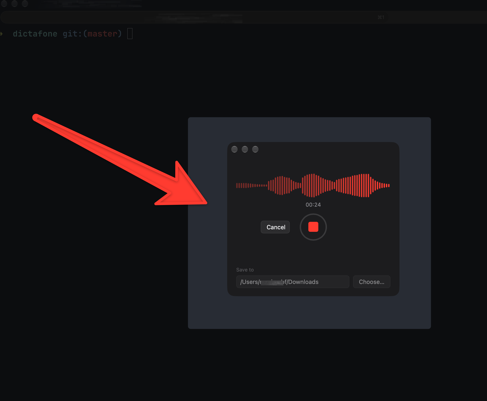

# Dictafone



A super simple dictaphone for macOS. Hit record, talk, hit stop, and get an MP3.

## Features

- One-click recording with a live waveform and timer
- Saves recordings as MP3 files named `Recording YYYY-MM-DD HH-MM-SS.mp3`
- Choose where recordings are saved
- Cancel a recording to discard it

## Built with

[Tauri 2](https://tauri.app) (Rust backend, plain HTML/CSS/JS frontend), [cpal](https://github.com/RustAudio/cpal) for audio capture and LAME for MP3 encoding.

## Install

```sh
git clone git@github.com:MaximeBF2000/dictafone.git
cd dictafone/
npm run tauri build
mv ./src-tauri/target/release/bundle/macos/Dictafone.app ~/Applications/Dictafone.app
```

## Development

Requirements: [Rust](https://rustup.rs) and Node.js.

```sh
npm install
npm run dev     # run the app in development
npm run build   # build the .app and .dmg bundles
```

The first time you record, macOS will ask for microphone access.
